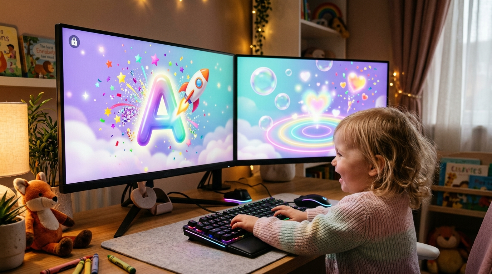

# 🌟 Mundo Mágico do Teclado (Keyboard Smasher)



Uma aplicação interativa concebida para crianças pequenas brincarem livremente com o teclado e o rato do computador, com animações encantadoras, cores dinâmicas e efeitos sonoros harmoniosos, cobrindo **todos os monitores** em simultâneo.

---

## ✨ Funcionalidades Principais

1. **Ecrã Total em Todos os Monitores:**
   - Deteta automaticamente qualquer número de monitores (1, 2, 3 ou mais) e as respetivas resoluções e coordenadas (incluindo ecrãs 4K e resoluções mistas com DPI Awareness).
   - Janelas sem margens que cobrem totalmente o ambiente de trabalho e barras de tarefas (`always-on-top`), impedindo que as crianças cliquem acidentalmente noutros programas ou ficheiros.

2. **Interação com o Teclado ("Keyboard Smash"):**
   - **Letras e Números:** Cada tecla premida faz saltar uma letra/número gigante e colorida acompanhada de um emoji divertido associado (ex: `A` 🚀, `B` 🎈, `C` 🐱, `1` 🥇, etc.).
   - **Explosões de Partículas:** Chuva de confetes coloridos, estrelas brilhantes, corações e bolhas que voam pelo ecrã.
   - **Teclas Especiais com Celebrações Globais:**
     - `ESPAÇO`: Lança um espetáculo de fogos de artifício em **todos os monitores em simultâneo**!
     - `ENTER`: Chuva de corações e flores em cascata com som de harpa celestial.
     - `APAGAR / BACKSPACE`: Chuva de bolhas de sabão a flutuar com sons de rebentar (*pop*).
   - **Monitores Conectados:** Quando uma tecla é premida num ecrã, os restantes monitores também disparam centelhas e estrelas para que todo o espaço fique vivo!

3. **Interação com o Rato:**
   - **Pó de Fada / Rasto Mágico:** Mover o rato deixa um rasto cintilante de estrelas e bolhas que flutuam e se desvanecem suavemente.
   - **Abanar o Rato:** Se a criança abanar o rato rapidamente, gera bolhas adicionais e sons de *pop*.
   - **Cliques (Esquerdo e Direito):** Criam ondas de choque circulares coloridas (*ripples*), confetes e sons alegres.

4. **Sons Harmoniosos (Escala Pentatónica):**
   - Todos os sons são gerados de forma procedural diretamente em memória (44.1 kHz estéreo), sem necessidade de ficheiros de áudio externos.
   - Utiliza a **escala pentatónica** (notas de xilofone / piano de brincar): qualquer sequência ou combinação de teclas que as crianças carreguem em simultâneo soa sempre **harmoniosa e relaxante**, sem ruídos estridentes para os pais!
   - Polifonia de múltiplos canais para que carregar em várias teclas ao mesmo tempo crie acordes musicais bonitos.

5. **Mudança Suave de Cores de Fundo:**
   - O fundo transita suavemente entre paletas acolhedoras e vibrantes (turquesa, roxo mágico, coral, azul oceano, lilás, etc.) sem flashes agressivos, mantendo o ambiente estimulante e seguro para os olhos.

---

## 🛡️ Segurança Parental (Proteção para Crianças)

As crianças pequenas carregam em todas as teclas aleatoriamente, incluindo no `ESC`. Para evitar que saiam do jogo sem querer:

- **Para Sair:** Mantenha a tecla **`ESC` premida durante 2 segundos**.
  - Surgirá uma barra de progresso visual elegante com a indicação *"A SAIR... Mantenha ESC premido (2s)"*. Se soltar antes dos 2 segundos, o fecho é cancelado e as crianças continuam a brincar.
- **Atalho Rápido para os Pais:** Prima `Ctrl + Shift + Q` ou `Alt + F4` para fechar imediatamente.
- **Controlos de Volume:**
  - `F1`: Silenciar / Ativar som.
  - `F2`: Diminuir volume.
  - `F3`: Aumentar volume.

---

## 🚀 Como Iniciar

### Opção 1 (Mais fácil):
Dê um duplo clique no ficheiro:
```bat
iniciar.bat
```

### Opção 2 (Via Linha de Comandos):
```powershell
python main.py
```

---

## 🛠️ Requisitos
- **Python 3.10+** (já instalado no sistema)
- **pygame-ce** (instalado automaticamente pelo `iniciar.bat` ou via `pip install pygame-ce`)
- Suporta Windows 10 e Windows 11 com múltiplos monitores.

